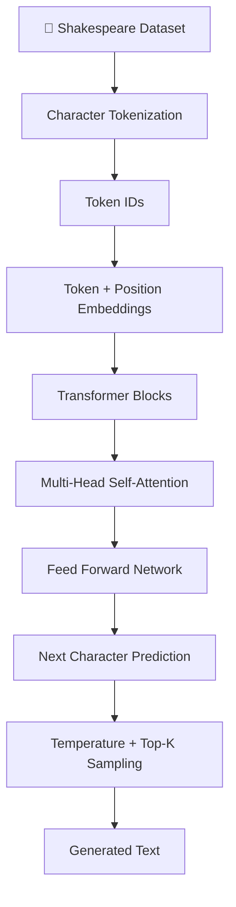
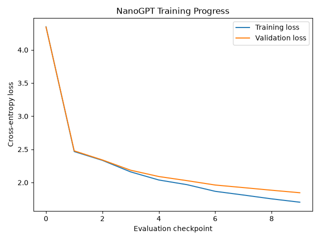

# 🧠 NanoGPT — teaching a tiny GPT to talk Shakespeare

*Built a mini GPT from scratch. Fed it Shakespeare. Now it has opinions.*

A small character-level GPT language model built using **Python + PyTorch**, trained on the Tiny Shakespeare dataset.

The idea? Understand what's actually happening inside GPT instead of just calling an API and hoping for the best.

It learns patterns from Shakespeare's writing and tries to generate its own Shakespeare-inspired text. Is it perfectly coherent? Absolutely not. Is it fun to watch a tiny Transformer learn language? 100%.

---

## ✨ What's happening here?

Basically, we're building a mini version of a GPT-style language model.

The model:
- Learns character patterns from Shakespeare's text.
- Converts characters into numerical representations.
- Uses self-attention to understand context.
- Predicts the next character.
- Repeats the process to generate new text.

All implemented using PyTorch, without relying on a pre-trained language model.

## 🏗️ The architecture



## ⚙️ Tech stack

- Python
- PyTorch
- NumPy
- Matplotlib
- Git & GitHub

## 🧩 Model configuration

| Hyperparameter | Value |
|---|---:|
| Vocabulary size | 65 |
| Batch size | 32 |
| Context length | 128 |
| Embedding dimensions | 128 |
| Attention heads | 4 |
| Transformer layers | 4 |
| Dropout | 0.1 |
| Learning rate | 3e-4 |
| Training iterations | 3,000 |

## 🧪 What I've implemented

- [x] Character-level tokenization
- [x] Text encoding and decoding
- [x] Bigram baseline
- [x] Token and positional embeddings
- [x] Multi-head causal self-attention
- [x] Transformer decoder blocks
- [x] Training and validation
- [x] Loss curve visualization
- [x] Model checkpoint saving
- [x] Autoregressive text generation
- [x] Temperature sampling
- [x] Top-K sampling

## 📉 Training results

Trained the model for 3,000 iterations and tracked training and validation loss.



Both losses show a decreasing trend, suggesting that the model is learning patterns from the dataset.

Not claiming it's Shakespeare 2.0 just yet. We're getting there. :)

## 💬 Let's see what it generates

**Current generation settings:**
- Temperature: `0.8`
- Top-K: `10`
- Maximum new tokens: `500`

**A tiny sample from the model:**

```text
The creased the so the from feer's his
Their chall from of me their, this we we ploce woom
I the well fair hear same, nevering man.
Were you bese broth moring,
Them in sain he is from chip sing and of the shood
```

It's giving Shakespeare, but make it experimental.

The model has learned some English-like character patterns, punctuation and dialogue structures, although its output is still largely incoherent.

## 📂 Project structure

```text
nanogpt/
│
├── data/
│
├── src/
│   ├── data.py
│   ├── bigram.py
│   ├── model.py
│   ├── train.py
│   ├── generate.py
│   │
│   └── outputs/
│       ├── gpt_model.pt
│       └── loss_curve.png
│
├── requirements.txt
├── README.md
└── .gitignore
```

## 🚀 Run it locally

**1. Clone the repository**

```bash
git clone <YOUR_REPOSITORY_URL>
cd nanogpt
```

**2. Create a virtual environment**

```bash
python -m venv .venv
source .venv/bin/activate
```

**3. Install dependencies**

```bash
pip install -r requirements.txt
```

**4. Prepare the dataset**

Place the Tiny Shakespeare dataset where `src/data.py` expects it.

**5. Train the model**

```bash
python src/train.py
```

**6. Generate text**

```bash
python src/generate.py
```

## 🔮 What's next?

Things I want to experiment with:

- Comparing different temperature values.
- Experimenting with different Top-K values.
- Training for more iterations.
- Trying different model configurations.
- Exploring perplexity and model evaluation.
- Understanding how different tokenization methods affect generation.

## 🧠 What I learned

This project helped me get a much better understanding of what's happening under the hood of GPT-style models:

- How tokenization works.
- Why embeddings matter.
- How self-attention captures context.
- How Transformers predict the next token.
- How training loss and validation loss help evaluate learning.
- How sampling strategies influence generated text.

## 🙌 Credits

Inspired by **Andrej Karpathy's** educational work on building GPT-style language models from scratch.

---

*Built with Python, PyTorch, curiosity, and probably too much debugging.*

